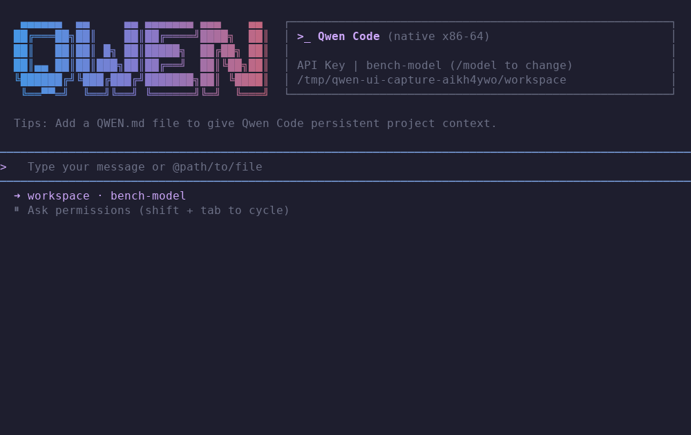
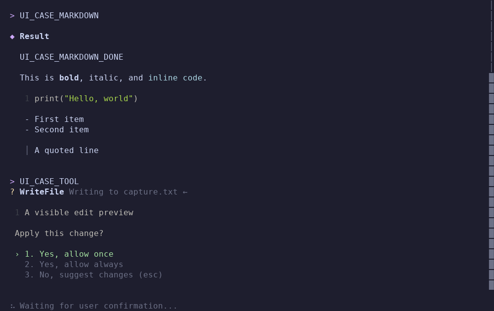
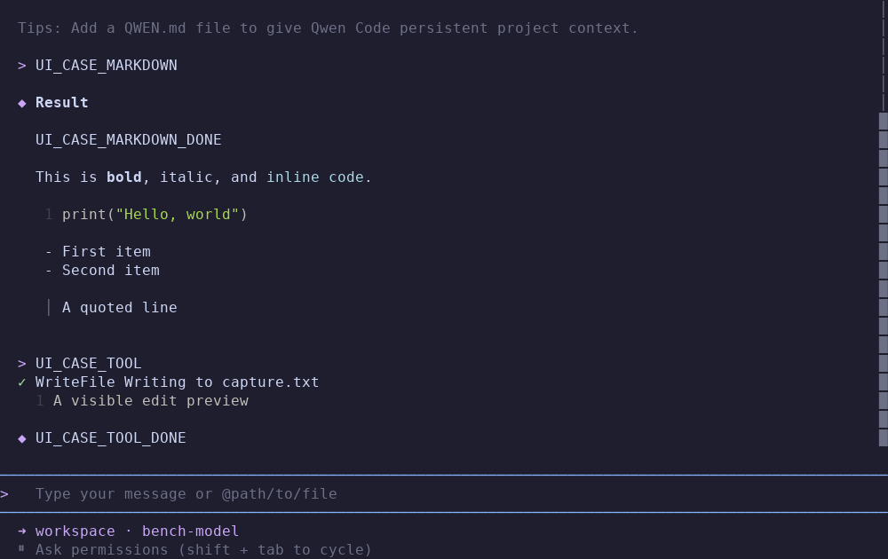
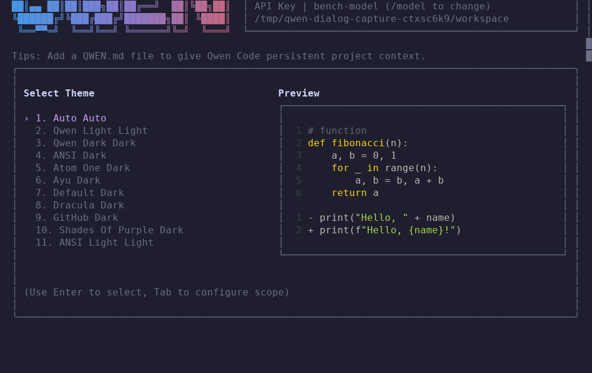
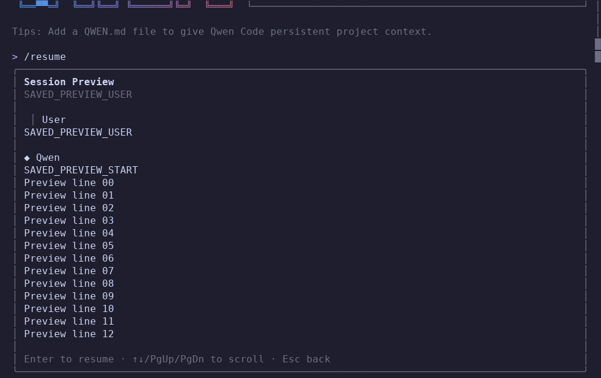
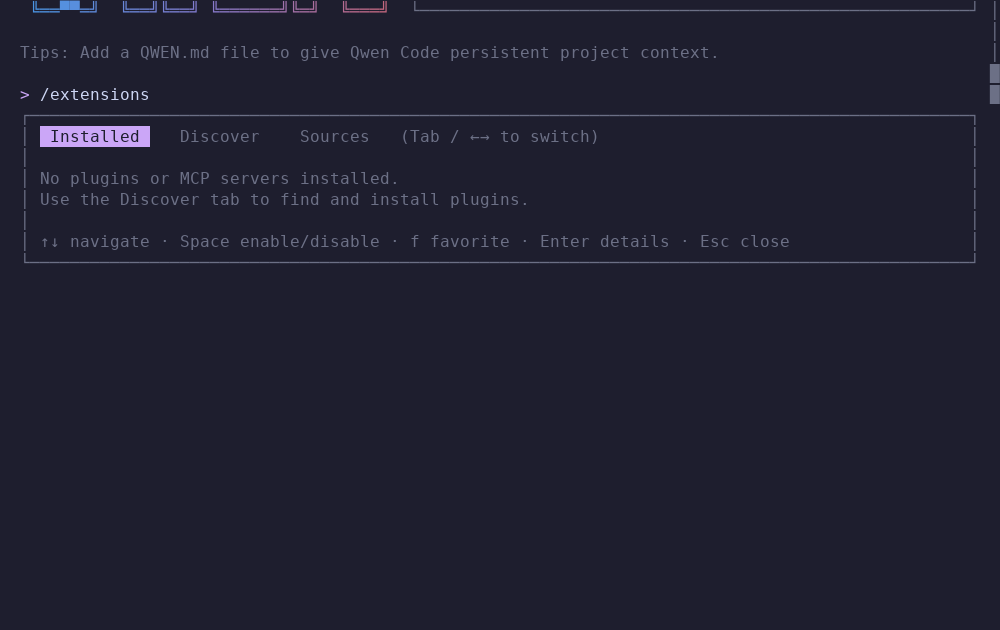
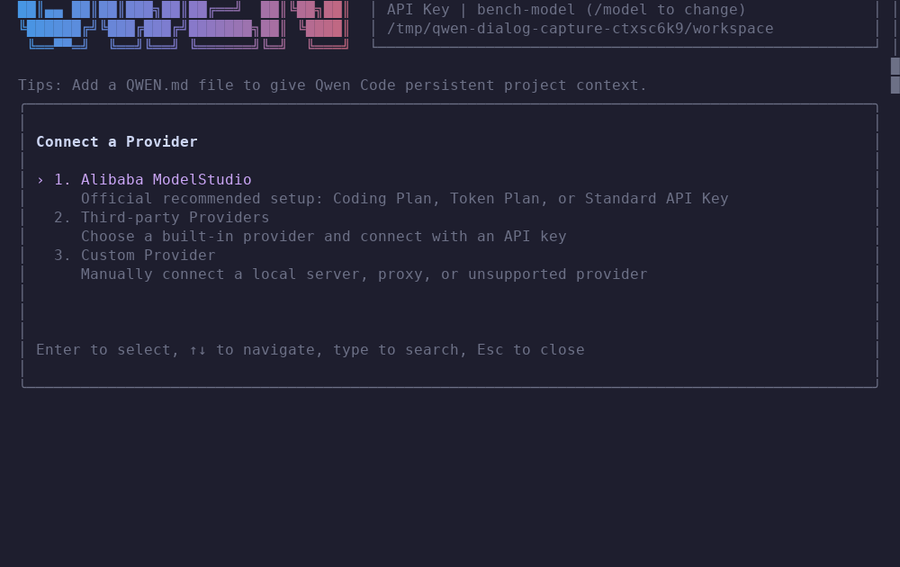
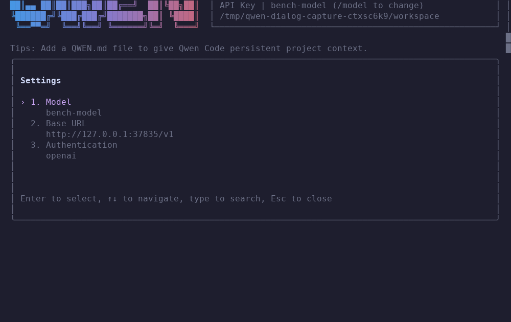

# qwen-x86

**Private UI checkpoint: 3,446,008 bytes (3.29 MiB)** — statically linked x86-64 assembly, including TLS and cryptography. No libc, Node.js, Go runtime, or shared TLS library.

[See the running assembly UI](#the-assembly-ui) · [Download the private review build](https://github.com/quivent/qwen-x86/releases/tag/v0.2.0-ui-checkpoint.2)

## Benchmarks

### Historical UI review: actual interactive rendering

These measurements describe `v0.2.0-ui-review.1` (267,216 bytes), not the current checkpoint.

Medians of three repetitions per client, 100×30 terminal, the same 56,033-byte response in 399 paced chunks. Lower is better. Timing and memory use separate passes; every full response is verified through a subsequent model request.

| Measurement | qwen-x86 UI review | Qwen Code 0.24.5 Ink |
|---|---:|---:|
| Launch → ready screen | 57.4 ms | 5,256.1 ms |
| First response byte → end visible | 991.8 ms | 1,659.4 ms |
| CPU after ready → end visible | 270.0 ms | 4,550.0 ms |
| Sampled peak process-tree PSS | 1.0 MiB | 449.9 MiB |

The stream is paced at 2 ms per chunk; terminal polling adds up to 100 ms. Startup includes tmux. These are local client measurements with different available feature sets, not real inference, WAN latency or proof of UI parity. [Timing data and limits](docs/ui-benchmark.json) · [Separate memory pass](docs/ui-benchmark-memory.json) · [Screen comparison](docs/ui-parity.md).

### v0.1.0 core-client tool-loop performance

The earlier core executable was **103,120 bytes**. Twenty randomized runs per variant and transport on this machine. Lower is better. The same five tool steps and their outputs are verified in each run.

| Client | HTTP median | HTTP p95 | HTTPS median | HTTPS p95 |
|---|---:|---:|---:|---:|
| **qwen-x86 optimized** | 41.8 ms | 52.6 ms | 47.6 ms | 70.4 ms |
| qwen-go | 100.6 ms | 117.9 ms | 65.6 ms | 93.7 ms |
| qwen-x86 before optimization | 205.7 ms | 301.6 ms | 236.5 ms | 274.6 ms |

The optimized HTTPS median is **4.97× faster than the assembly baseline** and **27.4% lower than Go**. These are client gaps between model responses and subsequent requests, excluding model preparation. TCP_NODELAY and kernel child-exit notifications remove avoidable waits. [Raw measurements, equations, and uncertainty](docs/wait-optimization.json).

### Three-client baseline

These earlier measurements preceded the wait optimization. Streaming and memory figures are five-run medians; memory was sampled in a separate pass. Startup uses 50 warm runs.

| Measurement | qwen-x86 baseline | qwen-go | Original JavaScript |
|---|---:|---:|---:|
| Warm `--version` startup | 0.35 ms | 3.53 ms | 66.91 ms |
| 64 KiB stream, first response byte → exit | 21.5 ms | 80.3 ms | 692.5 ms |
| Peak proportional memory during that stream | 0.37 MiB | 13.55 MiB | 257.98 MiB |

Local controlled fixtures measure client overhead. The clients have different feature sets; JavaScript includes extra default cleanup. These results do not measure real model inference, WAN latency, or interactive TUI rendering. [Usage methodology](docs/usage-benchmark.json) · [Startup methodology](docs/benchmark.json) · [Detailed optimization](#critical-path-wait-optimization).

**Private checkpoint on `fix/ui-parity`. Full UI parity is unfinished.** Known omissions are listed explicitly below; the project is paused for review.

A Linux x86-64 coding client written in GNU Intel-syntax assembly. The production executable is statically linked assembly: no libc, JavaScript engine, Go runtime, shared TLS library, or HTTPS helper process.


## The assembly UI

Recorded from the running assembly executable, using real terminal sessions and a local model fixture. These screens belong to the [private checkpoint build](https://github.com/quivent/qwen-x86/releases/tag/v0.2.0-ui-checkpoint.2). The implementation is under review in [PR #1](https://github.com/quivent/qwen-x86/pull/1).



| File approval | Completed write |
|---|---|
|  |  |

| Theme selection and live preview | Saved-session preview |
|---|---|
|  |  |

| Extension management | Agent management |
|---|---|
|  |  |

| Authentication | Settings — incomplete source equivalent |
|---|---|
|  |  |

[Compare the recorded states with Qwen Code](https://github.com/quivent/qwen-x86/blob/fix/ui-parity/docs/ui-parity.md) · [Raw terminal text and cell records](https://github.com/quivent/qwen-x86/tree/fix/ui-parity/docs/ui-captures)

**Full UI parity remains incomplete.** See the checkpoint’s known misses below.

## Checkpoint — 29 October 2026

**Paused for review at the user's request. Full Qwen Code UI parity is not achieved.** This checkpoint is on [`fix/ui-parity`](https://github.com/quivent/qwen-x86/tree/fix/ui-parity); the repository remains private. The current executable is **3,446,008 bytes (3.29 MiB)**. Its size includes approximately 3 MB of immutable ICU dictionaries for matching the reference's word editing; the application, TLS, cryptography and segmentation execute as static assembly.

This checkpoint adds native agent/extension management, session rename and multi-select deletion, text/image `@file` input, custom themes, controlling shell PTYs, persisted exact-command permissions, configured provider selection, masked account setup, and Anthropic/Responses/Gemini adapters. Native child mutations use parent approval; external Codex/ACP agents use their actual process protocols. These implementations and their tests do not establish complete source equivalence.

**The benchmark tables above describe earlier binaries. This checkpoint has not been benchmarked again.** [Current verification receipt](docs/ui-checkpoint-verification.json) · [Recorded comparisons](docs/ui-parity.md).

**Validation:** 490 tests passed; 1 optional public-network probe skipped (491 discovered). A source-only rebuild produced the identical executable. All 25 native capture records match its SHA-256.

### Known misses

- **Visual and interaction parity is unfinished.** Six recorded dialog borders now match the reference's positions and dimensions at 100×30. This is a geometry check, not a passing comparison of every cell, dialog state, theme or terminal size. Settings, authentication setup steps, populated management views and numerous source screens still differ.
- **Syntax highlighting is partial.** Qwen registers 37 common lowlight grammars. The native lexer has explicit profiles for Python, JavaScript/TypeScript aliases, Go, Rust, JSON, C/C++, SQL, Bash, YAML and assembly plus a common fallback. Full grammar modes, exact auto-detection scoring, regular-expression literals and template interpolation are unfinished.
- **Rich rendering still has differences.** Deeply nested Markdown styles and header recoloring are not exhaustively equivalent. All eleven source Mermaid families have native renderers, but advanced/malformed constructs lack exhaustive reference coverage; generic previews clip at 1,000 UTF-8 bytes rather than the source's 1,000 UTF-16 units.
- **Advanced mouse behavior is incomplete.** Composer hit-testing, selection, double/triple clicks, menu/dialog selection, wheel events, scrollbar movement and transcript clipboard extraction exist. Transcript selection highlighting, exact scrollbar thumb grabbing, the source right-click context menu and complete drag/autoscroll behavior are unfinished. Right-click currently copies the latest assistant response directly. These new integration paths lack complete end-to-end coverage.
- **Attachments cover explicit files, not the full source context system.** Quoted/escaped text paths and PNG/JPEG/GIF/WebP bytes enter actual model requests. Folder/glob expansion, full gitignore handling, clipboard image paste, PDFs/audio/video and the full session/extension/MCP mention system are missing. Individual files are currently limited to 256 KiB.
- **The full command catalog and its screens are not ported.** Examples include `/skills`, the source `/mcp` management panel, `/stats`, `/memory`, `/rewind`, `/branch`, `/export`, `/hooks`, `/effort`, `/output-style`, `/trust`, `/arena`, `/workflows`, `/goal`, `/language` and `/vim`. The bare source `/copy` action and ghost-text suggestions are also absent. Unknown slash commands fail explicitly.
- **Settings and provider setup are narrower than the source.** Native controls edit real connection/theme/approval state, but the complete settings schema, provider-specific validation, advanced setup and all wizard states are unfinished. Setup activates one selected preset model; it does not install whole preset model lists. There is one active private key, not a per-provider key registry; switching imported profiles relies on their environment key bindings. Vertex AI/ADC/service-account authentication is unavailable. Imported inline profile keys are not implemented.
- **Provider adapters cover tested flows, not every SDK feature.** Local fixtures verify text, local images, tool loops and replay of Responses encrypted reasoning/Gemini signed model parts. Extended-thinking presentation, every event/parameter, citations, complete usage metadata and every remote-image case remain unverified. No authenticated remote inference or real device authorization was performed for this checkpoint.
- **Agent definitions do not yet have full source policy semantics.** YAML is preserved and edited with framing/UTF-8 validation, not a full YAML/schema parser. Custom tool allow/deny lists, model/run configuration, approval overrides and related metadata are not fully enforced; unsupported custom executor/MCP/hook declarations fail explicitly. Inherited native workers expose the native base tools, not every parent MCP/plugin/delegation capability. Explore lacks the source's complete read-only shell classification and web/LSP/skill tools.
- **External agent behavior has remaining limits.** Actual Codex app-server and Claude ACP wire protocols are implemented and verified against process fixtures, not real billed accounts. Custom executor commands/arguments and complete thought/tool/progress/non-text presentation are missing. ACP follow-up requires advertised `session/load`; peers without it cannot retain a live session across worker restarts. Cleanup is verified for owned process groups, not descendants that create independent groups.
- **Shell permissions and presentation are not source-complete.** Persisted grants match exact commands in native state; source shell-AST prefix rules, deny/ask precedence and the complete permissions editor are absent. Direct shell input uses a real controlling PTY, but source inline focus/promotion UI, a persistent shell process/cwd and complete large-input backpressure coverage are missing.
- **Extensions support a subset of installation and lifecycle formats.** Sources CRUD, discovery, native enable/favorite state, uninstall, Git installation and atomic update are functional. Installation currently requires a Qwen-manifest Git repository. Nongit directory copies, Claude marketplace subdirectories/`plugin.json` conversion, npm/archive sources, refs/releases and all selector forms are missing. Discovery can expose entries the installer cannot yet install.
- **Native extension state is separate from original Qwen activation state.** Native markers control the native loader; they do not update Qwen's journal/preferences. Prompt commands/skills and approved MCP registration work, but complete hooks/workflows/context/settings/extension-agent lifecycles and linked installs are absent. MCP remote transport, pagination and the full source management UI remain unsupported.
- **Session compatibility is native-first.** Rename, preview, multi-delete and ACP continuation sidecars work for native sessions. Complete original Qwen session import, grouping, branching/rewind and attachment cleanup are missing. The source-format shell history wrapper remains ambiguous when a user types identical delimiters.
- **Verification has limits.** Five ICU dictionary engines and Unicode word rules match the recorded multilingual/emoji goldens; this is not proof for every `Intl.Segmenter` input. Matching screenshots, passing unit tests and local protocol fixtures must not be represented as a complete parity percentage. The existing restricted TLS/X.509 support documented below also remains unchanged.


## Install globally

The prebuilt Linux x86-64 UI review executable is available in [Releases](https://github.com/quivent/qwen-x86/releases/tag/v0.2.0-ui-checkpoint.2). This is a private, incomplete checkpoint for review; [remaining differences](docs/ui-parity.md) are explicit. It includes TLS and cryptography. Running it requires Linux x86-64, AES-NI, and a PEM CA trust store, normally `/etc/ssl/certs/ca-certificates.crt`.

While the repository is private, use an authenticated GitHub CLI account with repository access:

```sh
set -e
install_dir=$(mktemp -d)
gh release download v0.2.0-ui-checkpoint.2 --repo quivent/qwen-x86 --pattern qwen-x86-linux-amd64 --pattern SHA256SUMS --dir "$install_dir"
(cd "$install_dir" && sha256sum --check SHA256SUMS)
sudo install -m 755 "$install_dir/qwen-x86-linux-amd64" /usr/local/bin/qwen-x86
rm -r "$install_dir"
```

Then run it from any directory:

```sh
qwen-x86 login
qwen-x86
```

Or use an API key:

```sh
QWEN_API_KEY=your-key qwen-x86
qwen-x86 --prompt 'Inspect this workspace and explain its entry point'
```

For a user-only installation without `sudo`, replace the `sudo install` line with `install -D -m 755 "$install_dir/qwen-x86-linux-amd64" "$HOME/.local/bin/qwen-x86"` and ensure `~/.local/bin` is on your `PATH`.

<details>
<summary>Build from source (developers)</summary>

Requires GNU `as` and GNU `ld`. Clone using SSH and install the command into `~/.local/bin`:

```sh
git clone --branch v0.2.0-ui-checkpoint.2 git@github.com:quivent/qwen-x86.git
cd qwen-x86
make install
qwen-x86 --version
```

</details>

`login` (or `--login`) uses Qwen device authorization with native HTTPS and PKCE. It prints a verification URL and user code for browser approval, then saves a private cache at `~/.config/qwen-x86/oauth.json`. Access and refresh tokens are never printed. Native credentials refresh under a cross-process file lock; unexpired Go/Qwen Code caches can be reused read-only, and expired external caches require a native login. OAuth defaults to `coder-model` and the issued resource URL; explicit endpoint/model settings take precedence.

`--help` lists flags. `--cwd DIR` selects the workspace. `QWEN_BASE_URL` / `OPENAI_BASE_URL`, `QWEN_MODEL` / `OPENAI_MODEL`, and `QWEN_API_KEY` / `OPENAI_API_KEY` configure an OpenAI-compatible streaming endpoint. The client appends `/chat/completions` unless already present. Unencrypted HTTP is allowed only for `localhost` or `127.0.0.1`. `--ca-file FILE` supplies an explicit PEM trust store.

`--yes` explicitly permits workspace changes, unrestricted shell commands, and optional external MCP process startup/tool calls. Without it, terminal sessions ask for approval; headless sessions deny approval-dependent actions. Read-only subagents cannot write, run a shell, use external tools, or delegate even when the parent uses `--yes`.

## Features

- Native streaming SSE/JSON and multi-round tools with an assembly terminal UI: flowing Qwen header/composer, Markdown, common Mermaid diagrams, themes and permission previews.
- Unicode grapheme editing, multiline bracketed paste, undo/redo, separate prompt/shell histories, reverse search, workspace path completion and external editor integration.
- All 15 built-in reference themes plus Auto, OSC light/dark detection, `NO_COLOR`, user/workspace theme preferences and terminal restoration.
- Searchable native-session picker and read-only Space preview; Enter resumes. Tabbed help and explicit source-copy actions work without model requests.
- Busy input steering/queueing, mouse-wheel scroll and cancellation. See [UI review limits](docs/ui-parity.md) for unimplemented reference surfaces.
- Workspace-relative `read_file`, `list_directory`, atomic `write_file`, exact `edit_file`, and approved `run_shell`. File tools reject symlinks and parent traversal, with a 64 KiB text limit. Shell commands execute with the user's ordinary account permissions.
- Up to three concurrent forked agents, read-only by default, with parent approval for inherited writes, separate histories, saved follow-ups, waiting and cancellation. Codex/ACP external agents require their installed executables.
- Interactive Ctrl+C stops a running shell or MCP operation and skips remaining tool calls in that response. Canceled batches save matching tool results before returning to the prompt.
- Private atomic JSON session snapshots under `~/.local/state/qwen-x86/`; `--resume FILE`, `--no-save`, and `/new`.
- Shared Go-client prompt/skill plugin folders at `~/.config/qwen-go/plugins` and `.qwen-go/plugins`. List with `--plugins` or `/plugins`; invoke `/plugin:command` or `/skill plugin:skill`.
- Optional native stdio MCP client. Configuration loading does not launch servers. `list_mcp_servers`, then approved `connect_mcp_server`, exposes discovered tools. MCP protocol 2024-11-05; four local servers, sixteen tools per server. Remote transport and paginated discovery are unsupported.
- `qwen-x86 --mcp-serve` exposes its two read-only workspace tools as a native stdio MCP server, without model credentials.

The terminal filters model-supplied control sequences. Plugin prompts, repository files, and external tool results remain untrusted text; the model can still misunderstand them. Approval is a local execution boundary, not a claim that generated shell commands are harmless.

## Native network profile

The binary implements IPv4 hosts-file/DNS lookup, nonblocking TCP, HTTP/1.1 framing and persistent single-origin connections, TLS 1.3, SHA-256/HMAC/HKDF, X25519, AES-128-GCM, RSA verification, and bounded DER/PEM X.509 validation. HTTP POSTs are never automatically replayed after connection failure. Forked agents detach inherited network descriptors without closing the parent's TLS connection.

TLS offers `TLS_AES_128_GCM_SHA256`, X25519 key exchange, RSA-PSS/SHA-256 CertificateVerify, and RSA/SHA-256 signed certificate links. Validation includes trust, SAN hostnames, time, basic constraints/path length, key usage and EKU. An explicitly trusted anchor is matched by both subject and public key, allowing a differently signed wrapper of that same anchor. There is no name-only trust.

This deliberately bounded first implementation is not a general browser TLS/PKIX stack. It has no IPv6, proxy support, DNS TCP fallback, ECDSA, arbitrary signature algorithms, AIA fetching, revocation checking, session resumption, TLS KeyUpdate, or general DN normalization. Unsupported critical certificate constraints fail closed. Certificate validation precedes application credential transmission.

## Verification and measurements

```sh
make test
QWEN_X86_LIVE_TLS_TEST=1 python3 -m unittest discover -s tests -p test_tls.py -v
python3 tests/bench_client.py
```

Tests use Python, Python `cryptography`, and local OpenSSL-compatible TLS servers as independent test oracles. These are development dependencies only. Fixtures exercise cryptographic known-answer/random cases, malformed inputs, actual HTTPS model/tool/session flows, denial paths, process cleanup, and native parallel workers. The optional public probe performs verified TLS to the default API host without sending an HTTP request or credentials.

[The v0.1.0 verification receipt](docs/verification.json) records the earlier core executable, source hashes, static linkage, and test scope. It does not describe the UI review branch. Current UI evidence is tracked in [the parity review](docs/ui-parity.md).

[Benchmark results](docs/benchmark.json) compare the assembly and Go executables and the installed JavaScript command on this machine. They measure warm process startup and, for the native clients, idle offline-terminal memory, not remote model latency, sustained token throughput, or complete Qwen Code feature parity. No authenticated remote model run or real device authorization is implied by local fixtures. The native TLS handshake has separately been verified against `chat.qwen.ai`, `dashscope.aliyuncs.com`, and `dashscope-intl.aliyuncs.com` without sending HTTP or credentials.

## Usage performance before wait optimization

Measured on this machine with five repetitions per workload/client, after one warmup and with an isolated profile. Actual installed clients execute against a local deterministic model fixture. Every stream, file edit, shell checksum, and worker result is verified. Timing runs disable memory sampling; a separate five-run pass measures process-tree proportional resident memory (PSS).

| Workload / metric | Assembly | Go | Original JavaScript |
|---|---:|---:|---:|
| 64 KiB burst, first SSE body to process exit | 21.5 ms | 80.3 ms | 692.5 ms |
| 8 KiB paced stream, first SSE body to exit | 280.6 ms | 278.5 ms | 739.0 ms |
| Five HTTP tool steps, client gaps only | 200.5 ms | 60.6 ms | 717.5 ms |
| Five HTTPS tool steps, client gaps only | 233.5 ms | 68.6 ms | 568.8 ms |
| Peak PSS during burst stream | 0.37 MiB | 13.55 MiB | 257.98 MiB |

The five tools read about 32 KiB, write about 8 KiB, read the written file, edit one marker, and run `sha256sum`. Client gaps run from one completed response to the next request arriving, so exclude the fixture's fixed 20 ms preparation delay per response. Stream-to-exit numbers include output handling, session saving, shutdown, and the original JavaScript client's extra managed-memory request. Paced streaming adds 2 ms per content chunk. These measure client usage overhead; real model inference, WAN latency, and interactive TUI rendering are outside scope.

Two native workers each receive a 150 ms fixture delay and demonstrably overlap: response-to-exit median is 247.8 ms for assembly and 212.7 ms for Go. The JavaScript agent interface was not included in that comparison.

In that baseline, Go had lower tool round-trip latency, while assembly consumed less CPU and memory. The ACK diagnostic changes only server TCP acknowledgement scheduling: assembly's total HTTPS tool gap falls from 243.098 ms to 64.05 ms. Go stays near 64.35–72.797 ms. This supports Nagle/delayed-ACK interaction as a major cause. Go enables TCP_NODELAY; that baseline assembly binary did not. Its shell runner could also add a 100 ms child-reaping polling delay. Those baseline measurements preceded the optimization below.

Output mode matters: original JavaScript headless text mode exposes the first marker at 675.3 ms in this paced fixture; explicit `stream-json --include-partial-messages` exposes it at 13.4 ms (three runs). The text-mode figure does not establish interactive first-token latency.

The clients have different feature sets and default prompts. The JavaScript client performs extra default work, and HTTPS cipher negotiation differs (assembly AES-128-GCM; Go/JavaScript AES-256-GCM). Small timings remain sensitive to fixture and OS scheduling overhead.

[Full usage results and reproduction commands](docs/usage-benchmark.json), [ACK diagnostic](docs/tcp-ack-diagnostic.json), and [JavaScript streaming-mode check](docs/javascript-streaming-mode.json).

## Critical-path wait optimization

The five measured tool rounds form a dependency chain. Their cost is

```text
T_tools = sum(C_i + A_i + R_i + S_i), i = 1..5
C = useful critical-path processing
A = avoidable acknowledgement wait
R = child-exit detection delay
S = remaining scheduling and I/O waits
```

TCP_NODELAY now removes the Nagle/delayed-ACK gate between small request writes. The shell runner now uses a kernel pidfd exit notification, retaining the bounded polling fallback for unsupported/restricted kernels. Cancellation and command timeouts remain enforced. This allows transport progress and acknowledgement handling to overlap, and makes process completion event-driven; the tool dependencies stay ordered.

For a child exit `d > 0` after the first unsuccessful wait probe, periodic detection with period `P` adds `R(d) = P*ceil(d/P)-d`. Previously `P=100 ms`. A uniform phase would give mean `P/2`, but the short EOF/exit race can put `d` close to zero and produce almost a full 100 ms stall. The measurements do not assume a uniform phase. With pidfd, kernel wake and scheduler latency replace that timer quantization.

Twenty randomized blocks per transport compare four native ELF variants and the unchanged Go reference. The server retains its default ACK behavior, memory sampling is disabled, and each run verifies the same five tool operations. The predeclared target was an observed median and p95 below Go in both transports.

| Five-tool client gaps | HTTP median / p95 | HTTPS median / p95 |
|---|---:|---:|
| Assembly baseline | 205.7 / 301.6 ms | 236.5 / 274.6 ms |
| TCP_NODELAY only | 41.8 / 140.4 ms | 52.8 / 144.5 ms |
| pidfd only | 204.0 / 217.7 ms | 237.7 / 257.7 ms |
| Both optimizations | **41.8 / 52.6 ms** | **47.6 / 70.4 ms** |
| Go reference | 100.6 / 117.9 ms | 65.6 / 93.7 ms |

Both observed targets were met. HTTPS median improves 4.97 times against the baseline and is 27.4% lower than Go in this experiment. These are client gaps, excluding model preparation, and do not predict real model inference speed.

For factorial cell means `mu00`, `mu10`, `mu01`, `mu11`, average TCP saving is `(mu00-mu10+mu01-mu11)/2`, and average pidfd saving is `(mu00-mu01+mu10-mu11)/2`. HTTPS estimates are **184.6 ms** for TCP (95% paired-block bootstrap interval **174.2–194.7 ms**) and **10.3 ms** for pidfd (**0.4–21.9 ms**). Their sum equals the **194.9 ms mean total saving**. The smaller pidfd mean effect chiefly removes rare tail stalls; its median-effect interval crosses zero. Quantiles are reported separately rather than decomposed as though they were additive.

The intervals describe 20 paired randomized blocks on this machine. Observed p95 uses the nearest-rank estimate; it is not a population latency guarantee. [Raw runs, equations, hashes, and uncertainty](docs/wait-optimization.json). Reproduce with `python3 tests/bench_wait_optimization.py` after building the baseline object variants; the preserved original baseline inputs are in `build/wait-optimization/` on this machine.
