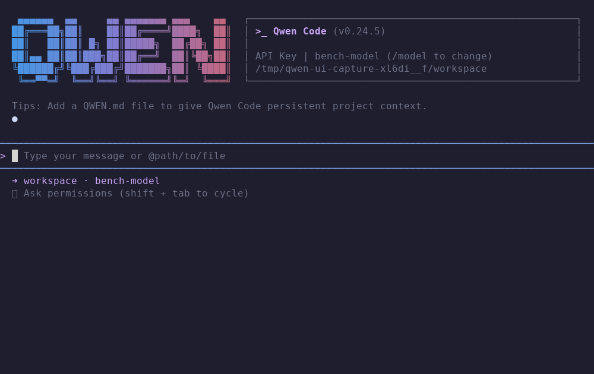
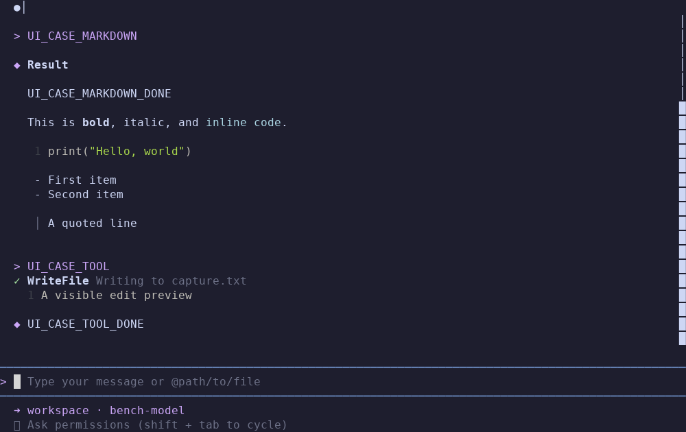
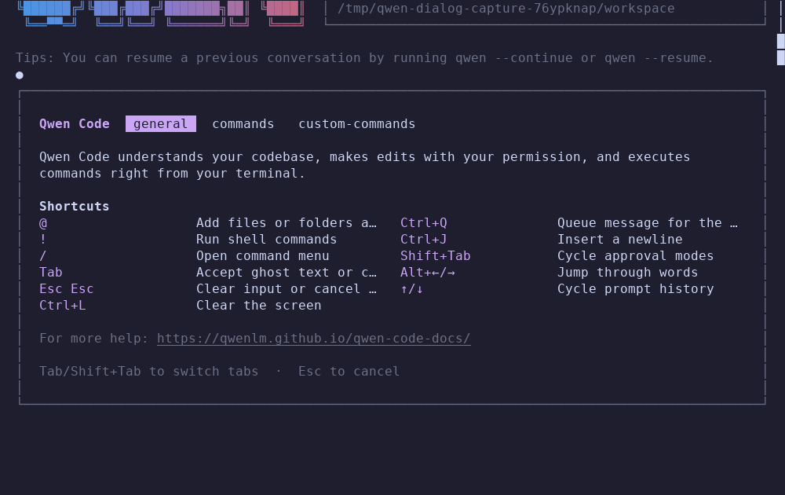
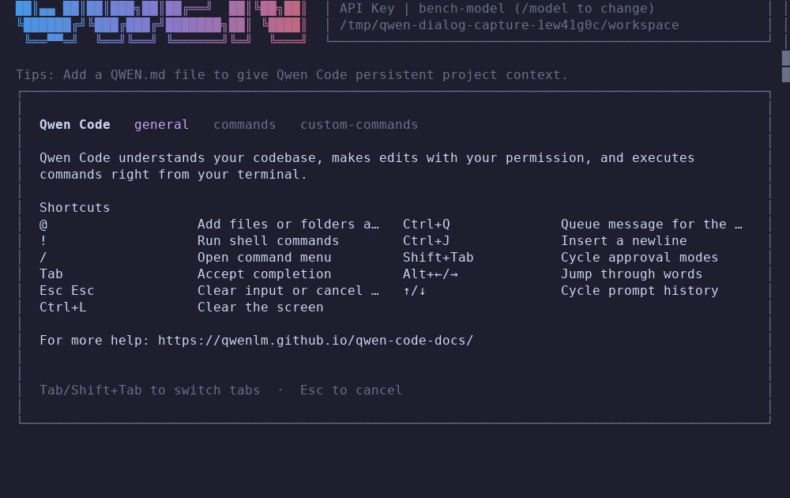
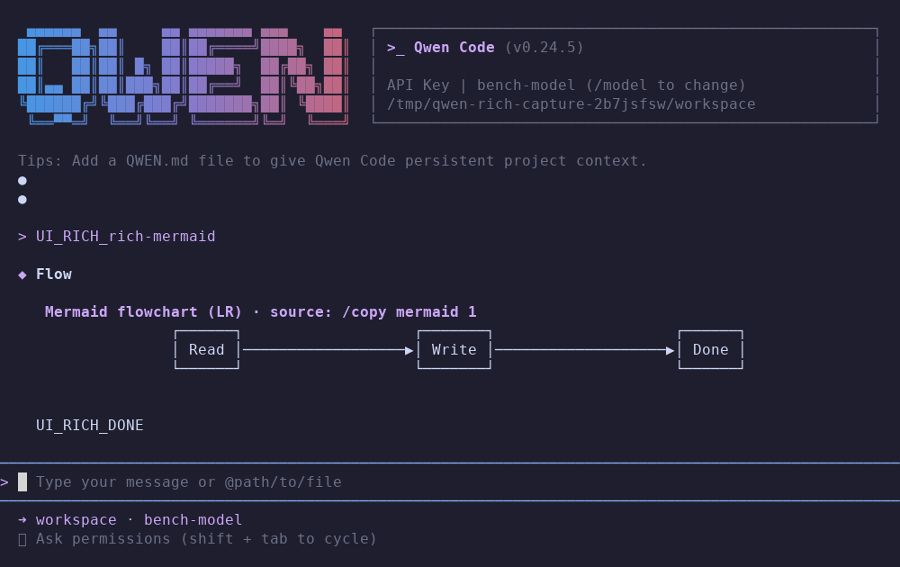
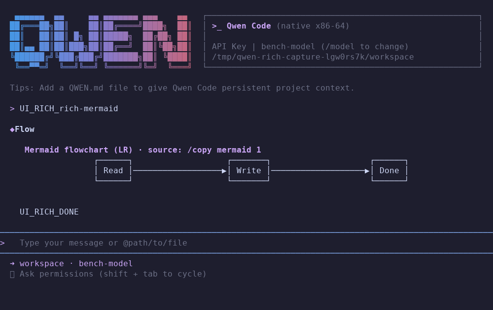

# UI parity review

Status: private review candidate; full UI parity is not achieved.

Current executable: **267,216 bytes (261.0 KiB)**. Full regression: **389 tests passed; one optional network probe skipped (390 discovered)**; the public TLS-only probe passed separately. A fresh source-only build produced the identical executable. [Exact hashes and verification scope](ui-verification.json). The existing v0.1.0 release is a core client with a reduced terminal interface. It does not meet the requested Qwen Code UI parity. The changes on `fix/ui-parity` are not a parity-certified release.

## Reference and evidence

The reference is the installed Qwen Code **0.24.5**, using its actual default **Ink** renderer, Node 22.23.2 and Unicode 17 segmentation. `QWEN_TUI_RENDERER=opentui` is not enabled. Captures run the real reference executable and real assembly executable through separate tmux terminal emulators, isolated home directories and the same controlled local model fixture. Auto-update and telemetry are disabled in those isolated profiles. No production account or paid inference is used.

`tests/ui_capture.py` records terminal text, styled escape output, cell attributes, cursor position/visibility and a PNG rendered from those cells. PNG font rendering is a review aid; tmux's cells and the actual PTY behavior are the terminal evidence. PNGs show captured cells; a hardware cursor is recorded separately, while the reference's synthetic cursor can appear in the cell image. `tests/capture_ui_dialogs.py`, `tests/capture_ui_rich.py` and `tests/capture_ui_sessions.py` add real dialogs, tables/math/diagrams and sessions created by each client. `tests/capture_ui_parity.py` captures startup at 80×24, 100×30 and 120×40, slash suggestions, Markdown, an actual write approval, tool completion, a long response, scrolling and resizing. Captures live in [ui-captures](ui-captures/manifest.json). Open the [side-by-side review](ui-captures/index.html) to compare images and terminal text, including a 50% overlay. Changing paths, version strings and reference-only notices can differ legitimately; layout, focus and actions still require comparison.

Capturing the two clients is not itself a passing comparison. These are review artifacts. No pixel/cell identity percentage or overall parity percentage has been established.

## Implemented for comparison

The new production UI is assembly. Python, Pillow, pyte and tmux are development tools only.

- Qwen logo and information panel with responsive visibility; source-derived default semantic colors and syntax palette.
- Flowing header and composer, logical transcript, Markdown, wrapping, scrolling, resizing and editable multiline composer. Approvals retain the conversation and show numbered file/edit/command previews.
- Unicode 17 grapheme movement/deletion, visual-line movement, bracketed paste, undo/redo, history and reverse search. Word segmentation still differs for dictionary-segmented scripts.
- Streaming updates while accepting edits and cancellation; a bounded FIFO for queued prompts and retained drafts.
- Boxed searchable model/theme/session dialogs, code/diff theme preview, real configured-model metadata, saved native-session replacement and backend approval modes.
- Direct user shell mode without model requests, separate persistent per-workspace shell history, cancellation and native session restoration.
- Working cumulative `/copy latex N` and `/copy mermaid N` actions copy original source through an explicit terminal clipboard request.
- Default SGR mouse-wheel tracking with three-line scroll steps and terminal-mode restoration.
- User-initiated external editor and native workspace path catalog. File completion uses bounded traversal and built-in dependency/build exclusions, not a full gitignore engine.
- Sanitized untrusted output. Model/tool text cannot emit arbitrary terminal escapes; explicit clipboard actions are separately controlled.

Tests verify individual behaviors and production PTY flows. They do not prove all reference states match.

## Differences and acceptance work remaining

This list must shrink through implemented, observed behavior, not by changing the definition of parity.

- Recapture the latest dialog and approval changes and review remaining line spacing, focus, scrolling and terminal-size differences against the real reference.
- Native session preview, search/commit/back/resume and paired-column help are functional and tested. Reference delete/rename/multiselect session actions, plugin/agent management panels and their complete behaviors remain different or absent.
- All 15 built-in source themes plus Auto are available; User/Workspace preferences persist, with workspace precedence. Custom theme loading, broader provider/account controls and full plugin/agent management remain different. Model overrides are currently session-local.
- Tool-preview code/gutter styling, full syntax highlighting, proportional table wrapping, clipboard image/attachment handling and the full source command catalog are not complete equivalents. Mermaid supports common flowchart, sequence and class grammar; other types use an explicit source fallback. Direct shell mode and its separate persistent history are implemented, but interactive child PTYs remain different.
- Shell "always allow" does not yet implement Qwen's persisted project/user permission rules. Native write/edit "always allow" does activate the session's auto-edit mode; a production workflow verifies subsequent distinct writes and edits.
- File/image attachment expansion, dictionary-based word segmentation, real authenticated provider use, all provider/error states and complete reference session compatibility have not been established. Fixture results cannot stand in for these.
- Reference concurrency, background-task and advanced agent/plugin/MCP screens exceed the current native backend feature set.

The older benchmark JSON files and release-size figure apply to the earlier core executable. [Interactive checkpoint measurements](ui-benchmark.json) separately measure the real renderer, record its exact binary hash, and verify the complete streamed assistant text through a subsequent request. They include controlled pacing and terminal polling, use only three repetitions, and do not establish feature parity. A later UI binary requires a new measurement or an explicit historical label.

## Reproduction

Build with `make`, then use an isolated development Python environment with `pyte` and `Pillow` and an installed `tmux`:

```sh
python tests/capture_ui_parity.py --client both
python tests/capture_ui_dialogs.py
python tests/capture_ui_rich.py
python tests/capture_ui_sessions.py
python scripts/build_ui_review.py
python -m unittest discover -s tests -p 'test_*.py' -v
```

The capture reference currently resolves `~/.local/bin/qwen`. Check it is still 0.24.5 before regenerating; a changed reference requires an explicit baseline update. The capture fixture does not remove its temporary isolated workspaces automatically, so both clients can be inspected after recording.

Shell restoration recognizes the complete source-format synthetic history wrapper and never executes restored text. That unescaped text format cannot distinguish a manually typed byte-identical wrapper or an embedded delimiter in a command; full UI metadata persistence would be needed to remove that ambiguity.

In the recorded reference 0.24.5 Ink/tmux session-preview case, the preview viewport was blank even though Enter resumed the correct saved history. The raw reference capture is retained and is not counted as a visual match. The native preview displayed the saved transcript and passed read-only/cancel/resume checks.

## Captured examples

These images show observed states, including differences. Open the interactive comparison for all 23 paired states and raw terminal text.

| State | Qwen Code reference | Native assembly |
|---|---|---|
| Startup |  |  |
| Completed write |  |  |
| Help |  |  |
| Mermaid |  |  |
