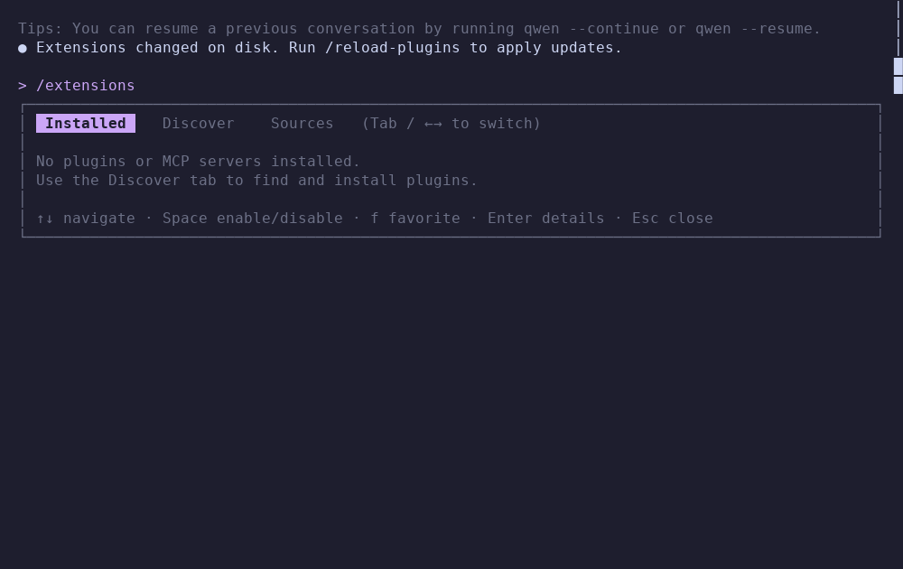
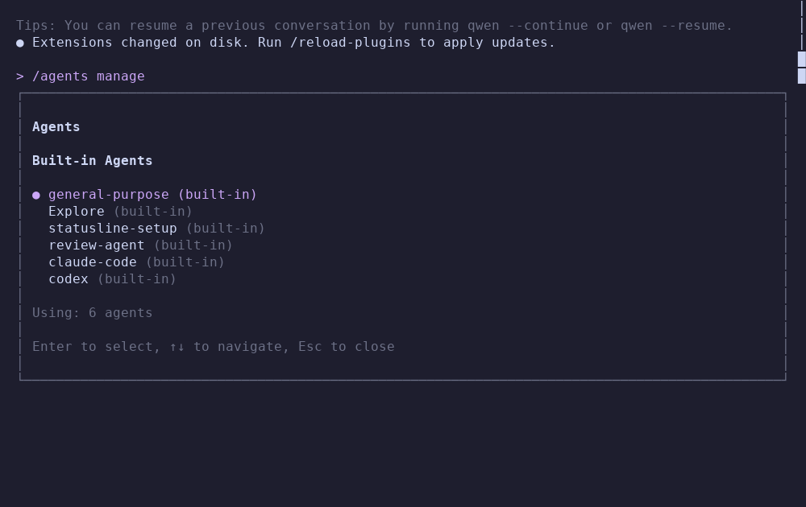
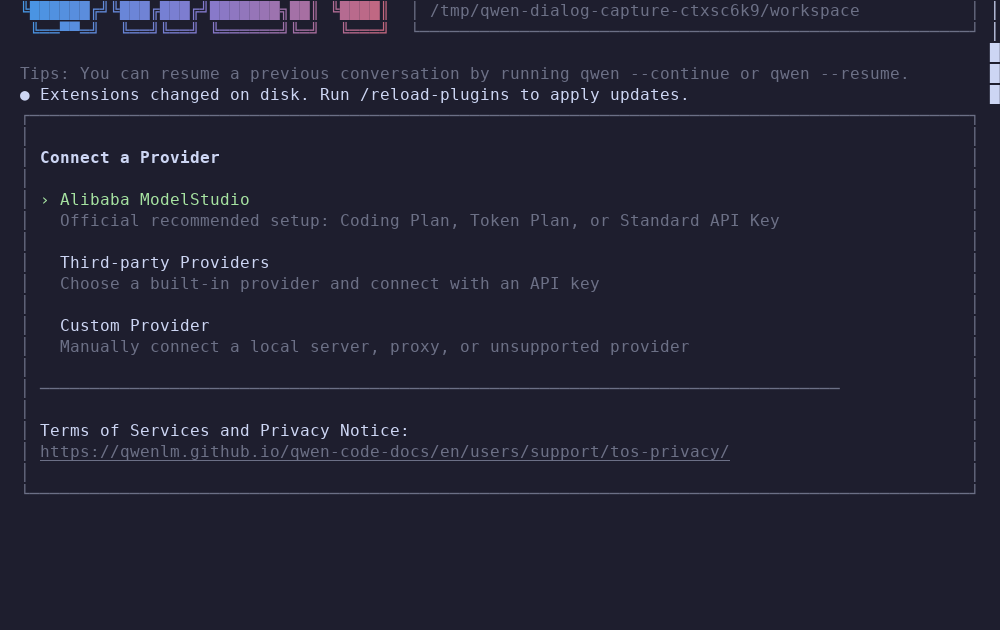
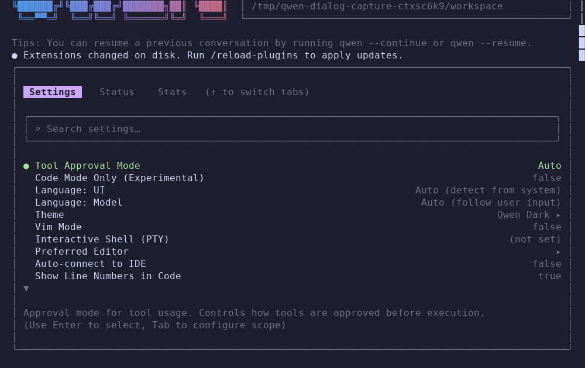

# UI checkpoint review

Status: paused for private review at the user’s request. **Full UI parity is not achieved.**

The complete known-misses list is in the [README](../README.md#known-misses). It includes unported screens/commands, syntax grammars, advanced mouse behavior, attachment/context expansion, agent policies, extension formats/lifecycles and provider setup limitations. This document records evidence, not an overall parity certification.

## Reference and capture method

The reference is installed Qwen Code **0.24.5**, using its actual default **Ink** renderer, bundled Node 22.23.2, ICU 78.2 and Unicode 17. OpenTUI is not enabled. Separate tmux terminals run the real reference and assembly executable with isolated homes and a controlled local model fixture. Auto-update and telemetry are disabled in the isolated reference profiles. No authenticated model account or paid inference is used.

`tests/ui_capture.py` records actual terminal text, styled escape output, cell attributes and cursor state, then renders those cells as PNGs. It now replays full graphemes: pyte 0.8.2 otherwise drops the rest of a same-color text run after a zero-width variation selector. That development-tool bug could hide words in a PNG which were present in the actual tmux transcript. Raw `.txt` and `.ansi` records remain available. Font rendering is a review aid; the terminal records are the underlying evidence. A hardware cursor is recorded separately.

Captures include startup at 80×24, 100×30 and 120×40; completion; Markdown; an actual write approval/completion; long output, scrolling and resizing; model/theme/session/extension/agent/help/auth/settings dialogs; tables/math/diagrams; and populated saved-session preview/resume. The [side-by-side and 50% overlay reviewer](ui-captures/index.html) loads the paired records. No overall cell identity or parity percentage is asserted.

The latest 100×30 comparison verifies equal outer border coordinates for Model, Theme, Resume, Extensions, Agents and Help. It does **not** establish matching contents or every interaction. The Settings and provider setup implementations remain narrower than the reference, and those screens are included for review rather than hidden.

## Verification and historical results

The [current checkpoint receipt](ui-checkpoint-verification.json) records the executable size/hash, production source hashes, final regression results, source-only rebuild and capture scope. [The earlier review receipt](ui-verification.json) describes the historical 267,216-byte executable, not this larger dictionary-inclusive checkpoint.

The existing timing/memory benchmark JSON files measure earlier binaries. They were not rerun for this checkpoint and cannot establish current performance or feature parity.

The current assembly includes source-derived Unicode word rules and compressed ICU dictionaries for CJK, Thai, Lao, Myanmar and Khmer, including weighted/three-word dictionary algorithms and normalization. Recorded goldens exercise all five engines; finite examples are not a formal proof of every `Intl.Segmenter` input. [Dictionary provenance and hashes](third-party/ui-dictionary-provenance.json) · [License](third-party/unicode-license.txt).

## Reproduction

Build with `make`. Development-only capture packages are pinned in `scripts/requirements-ui-captures.txt`; tmux and the installed 0.24.5 reference are required for capture. Node/Python are development oracles/generators, not application runtime dependencies.

```sh
python tests/capture_ui_parity.py --client both
python tests/capture_ui_dialogs.py --client both
python tests/capture_ui_rich.py --client both
python tests/capture_ui_sessions.py --client both
python scripts/build_ui_review.py
make test
```

`QWEN_UI_NATIVE_BINARY=/absolute/path/to/executable` pins the exact executable used for captures; its SHA-256 is recorded with every native state. User-specific paths, application identity, changing tips and reference-only extension notices are not constant strings. They do not justify ignoring layout, focus, actions or content differences.

In the retained reference 0.24.5 Ink/tmux session-preview case, the preview viewport was blank even though Enter resumed the correct saved history. That source observation is retained and is not counted as a visual match. Native preview displays the saved transcript. Shell history restoration still has the delimiter ambiguity documented in the README.

## Captured examples

| State | Qwen Code reference | Assembly checkpoint |
|---|---|---|
| Startup |  |  |
| Extensions |  |  |
| Agents |  |  |
| Authentication |  |  |
| Settings |  |  |
| Completed write |  |  |
| Mermaid |  |  |
